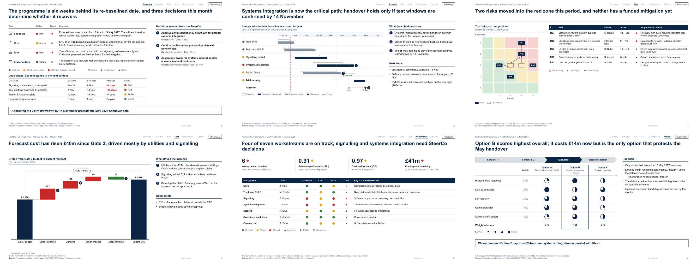
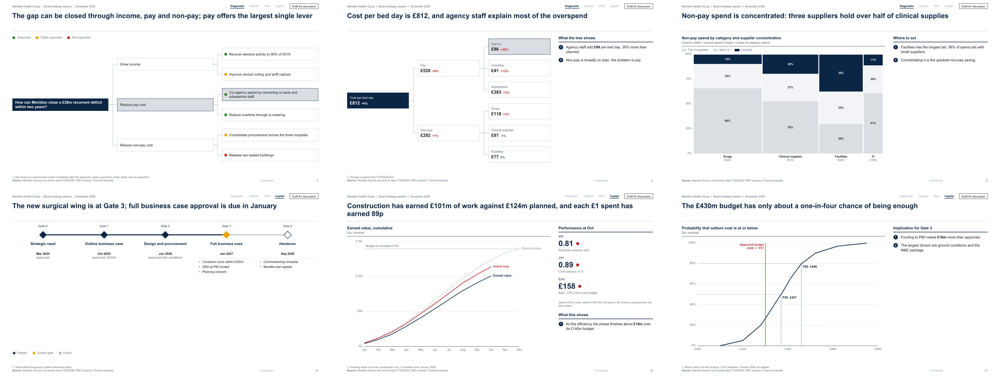
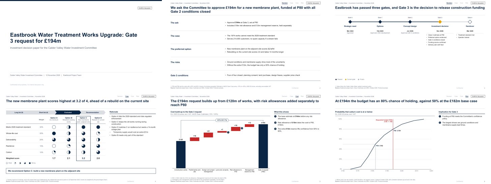
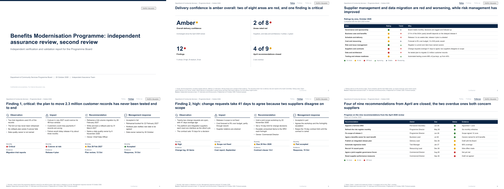
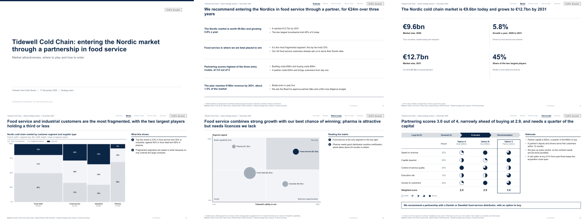
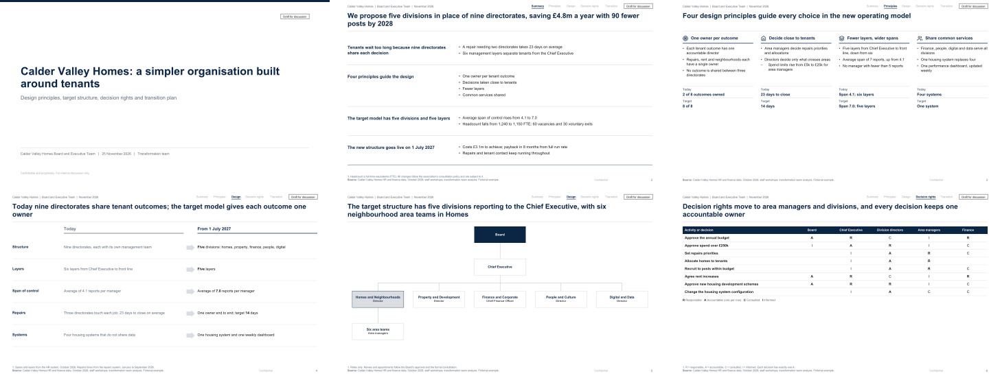
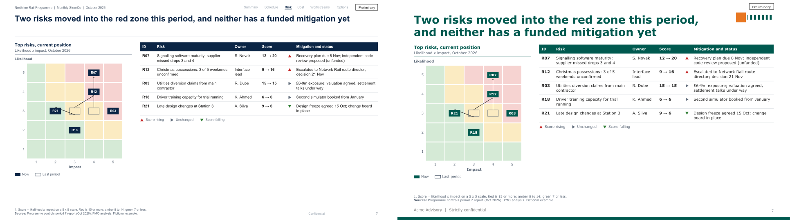
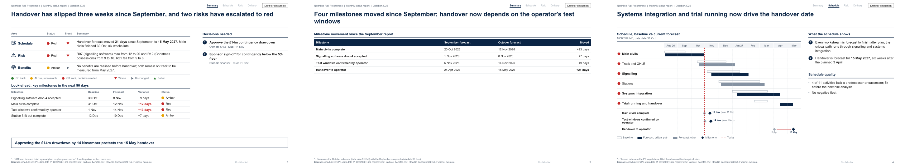

# Consulting Deck Studio

**An open-source AI agent skill that builds consulting-grade decks for PMO, capital projects, strategy and management
consulting.** It reads your meeting notes, transcripts, schedules and registers, then plays back what it found and asks
only the questions it still needs. It applies your company's template and writes action-titled, sourced slides in plain
human language. You get an **editable PowerPoint** plus **HTML and PDF that match it exactly**.

It works in **Claude Code, Codex, Gemini CLI, OpenCode, Hermes, Grok, Cursor, GitHub Copilot, Windsurf, Kiro, Cline,
Goose, Amp and Antigravity**, or any agent that reads `SKILL.md` skills. It needs only Python 3, with no pip or npm
installs.



---

## Why it's different

| Most AI deck tools | Consulting Deck Studio |
|---|---|
| A fixed questionnaire, or no questions | Reads your files first, plays back what it inferred, then asks **3-5 questions that change the storyline**, each with a default |
| Topic titles ("Cost update") | **Action titles** that state the takeaway. A titles-only "ghost deck" is approved before slides are built, then checked for MECE structure and for whether the titles alone tell the story |
| Invented numbers that sound plausible | A **facts ledger**: every number traces to a file, sheet row or speaker. Unknowns stay visible as `[[placeholders]]`. SPI, CPI, P-values and variances are **computed**, not typed |
| Generic styling, or another firm's look | **Your template**: give it a `.potx` or `.pptx`, and the PPTX is built on your real master, layouts, fonts and colours. Or it takes colours, fonts and logo from your website. There is a neutral house style if you have neither |
| PPTX export that drifts from the preview | **PPTX = HTML = PDF.** One layout engine draws all three, with pre-broken lines, calibrated baselines and editable shapes. A pixel check compares them |
| Pretty decoration | **Typical consulting slides**: exhibit plus takeaways, numbered callouts, unit lines, RAG with definitions, trends, footnotes and sources. Icons are sparse and monochrome |
| Starting from a blank page every month | **Linked to your project**: re-read the P6 schedule and registers each period, see what moved since last month, and refresh the deck |

## What it builds

**36 deck types** across four practices, each with a playbook covering default sequence, mandatory content, what to
ask and common pitfalls:

| PMO | Capital projects | Strategy | Management |
|---|---|---|---|
| Monthly / weekly status report | Investment decision / gate paper | Strategic diagnostic | Operational diagnostic |
| SteerCo / programme board pack | Independent cost & schedule review | Growth strategy & options | Cost reduction / efficiency review |
| Programme / portfolio dashboard | Cost-to-complete / estimate review | Market entry & attractiveness | Operating model & org design |
| Risk review (RAID) | QRA / schedule risk analysis results | Commercial due diligence summary | Transformation roadmap & business case |
| Schedule review / recovery | Delivery model & procurement | Portfolio strategy | Transformation office SteerCo |
| PMO set-up & governance | Capital programme prioritisation | Economic development strategy | Post-merger integration |
| Go-live readiness | Recovery plan | Board strategy update | Public-sector service review |
| Assurance / health check / IV&V | Contingency & change control | Scenario planning | Change & adoption plan |
| Benefits review | Owner's rep monthly report | | |
| Close-out & lessons learned | Benchmarking | | |

**35 layouts:**
- **Structure:** exec summary (dot-dash), status summary with decisions and look-ahead, RAG dashboard, decisions,
  agenda, section, columns with comparison strip
- **Schedule and risk:** Gantt (baseline vs forecast, float, milestone slips), 5×5 risk heat map with movement, RAID log
- **Charts:** waterfall (must reconcile), bar and column with CAGR, line, Marimekko, scatter and bubble, benchmark (the
  median is computed), tornado, 2×2
- **Capital controls:** S-curve with computed SPI/CPI/EAC, P-curve with computed P50/P80 and the budget's confidence
  level, benefits tracker, stage gates
- **Logic and organisation:** issue and driver trees, process flow, roadmap, timeline, org chart, RACI (exactly one A
  per row)
- **Text and evidence:** options matrix (weights must total 100%), before/after, key numbers, quotes



## Gallery: one deck per type

**[See all 12 example decks →](docs/gallery.md).** Each one has its PPTX, PDF and `deck.md` source. They cover a
monthly status report built from project files, a SteerCo pack, an IV&V assurance review, a risk review, a Gate 3
paper, an independent cost and schedule review, market entry, a growth strategy, a diagnostic plus capital programme,
an operating model, a post-merger integration plan, and the same pack on a client template.

| | |
|---|---|
|  |  |
| **Capital:** Gate 3 investment decision paper | **PMO:** independent assurance / IV&V review |
|  |  |
| **Strategy:** market entry | **Management:** operating model and org design |

## Your template, your brand



```bash
python3 skills/consulting-deck-studio/scripts/template_from_pptx.py your-template.potx my-deck/
```

The skill asks for a template deck before anything else. From your `.potx` or `.pptx` it reads:
- the slide size
- theme colours and fonts
- the Title Only, Title and Section layouts
- the title placeholder style and position
- the slide-number position
- where the logo and footer sit, so nothing overlaps them

The output PPTX uses **your real master**: colleagues open it and they are in their normal template. Titles and page
numbers are real placeholders. If a font isn't installed, it uses a metric-compatible stand-in (Carlito for Calibri)
or asks for the font files.

## Linked to your project files



| Input | Read as |
|---|---|
| Primavera P6 `.xer`, MS Project `.xml` | Activities, planned vs forecast vs actual, float, critical path, logic, and schedule-quality checks |
| `.xlsx` / `.csv` registers | Risk, RAID, benefits, milestones and cost. Column headers are recognised automatically, and "Very high" becomes 5 |
| `.vtt` / `.srt` / `.txt` transcripts (Teams, Zoom, Otter, Granola, Fireflies) | Speakers and turns, with candidate decisions, actions and risks to confirm |
| `.docx` / `.md` notes, last month's `.pptx` | Text, tables and per-slide titles and notes |

```bash
S=skills/consulting-deck-studio/scripts
python3 $S/init_project.py my-deck --name "Northline" --practice pmo --deck status-report --source plan.xer risks.xlsx raid.csv
python3 $S/ingest.py my-deck --refresh            # re-read every source, re-emit slide data
python3 $S/ingest.py my-deck --diff 2026-09       # milestones moved, risks re-scored, new or closed
python3 $S/build.py my-deck --pdf --sheet --parity
python3 $S/ingest.py my-deck --snapshot 2026-10   # next month compares against this
```

Slides pull their data straight from the files (`data_from: research/emit/gantt.json`). RAG comes from the slip against
plan using your tolerances, and heat-map arrows come from last period's register.

## The research inside

- **[164 real consulting decks and reports](skills/consulting-deck-studio/references/library.md)** from MBB, the Big
  4 and specialist firms, each verified by opening it, and tiered:
  - **Tier 1:** authored by MBB or Big 4
  - **Tier 2:** client material presenting their work
  - **Tier 3:** specialist firms

  Each record holds the slide sequence, storyline, signature slides, standout moves and weaknesses. Query it with
  `find_decks.py --practice pmo --type assurance`. Coverage is uneven, and the library says so: public PMO and capital
  slide decks from the big firms are rare.
- **[Standards](skills/consulting-deck-studio/references/standards.md):** GAO schedule and cost guides, AACE estimate
  classes, UK Gateway (NISTA), earned value, QRA practice, and RAG conventions, each marked verified or convention.
- **[Slide craft](skills/consulting-deck-studio/references/slide-craft.md),
  [storyline](skills/consulting-deck-studio/references/storyline.md) and
  [copy](skills/consulting-deck-studio/references/copy.md):** the pyramid principle, SCQA, MECE, horizontal and
  vertical logic, exhibit choice, and plain-language rules with a banned-phrase list the build enforces.

## Install

### Any agent, one line (recommended)
```bash
npx skills add ali-lari1/consulting-deck-studio -g
```
This uses Vercel's [skills CLI](https://github.com/vercel-labs/skills), which detects your agents. Add
`-a claude-code -a codex` to choose specific ones. Or:
```bash
gh skill install ali-lari1/consulting-deck-studio        # GitHub CLI v2.90+
curl -fsSL https://raw.githubusercontent.com/ali-lari1/consulting-deck-studio/main/install.sh | bash
```

<details><summary><b>Claude Code</b></summary>

```
/plugin marketplace add ali-lari1/consulting-deck-studio
/plugin install consulting-deck-studio@consulting-deck-studio
```
Or `git clone` and run `./install.sh`, which links into `~/.claude/skills`. Invoke it with `/consulting-deck-studio`,
or just ask for a deck.
</details>

<details><summary><b>OpenAI Codex CLI</b></summary>

`npx skills add ali-lari1/consulting-deck-studio -g -a codex`, or `./install.sh` (installs into `~/.agents/skills`).
</details>

<details><summary><b>Gemini CLI / Antigravity</b></summary>

`gemini extensions install https://github.com/ali-lari1/consulting-deck-studio`, or `./install.sh`. For Antigravity:
`agy plugin install https://github.com/ali-lari1/consulting-deck-studio`.
</details>

<details><summary><b>OpenCode, Hermes, Grok, Cursor, Copilot, Windsurf, Kiro, Cline, Goose, Amp</b></summary>

`./install.sh` links into every agent it detects. Add `--all` to write every known location, or `--project` to install
into `./.agents/skills` and `./.claude/skills`. Hermes: `hermes skills install
ali-lari1/consulting-deck-studio/skills/consulting-deck-studio`. Grok: `grok plugin marketplace add
ali-lari1/consulting-deck-studio`.
</details>

<details><summary><b>Windows</b></summary>

```powershell
git clone https://github.com/ali-lari1/consulting-deck-studio
cd consulting-deck-studio
powershell -ExecutionPolicy Bypass -File install.ps1
```
</details>

<details><summary><b>Any other agent</b></summary>

Copy `skills/consulting-deck-studio/` into the agent's skills folder. If it doesn't support skills, paste
[`AGENTS.snippet.md`](AGENTS.snippet.md) into its `AGENTS.md` or rules file.
</details>

**Requirements:**
- Python 3.8+.
- Optional: any Chromium-family browser, for PDF export and the contact sheet.
- Optional: LibreOffice, for the automatic PPTX/HTML match check. Without it, check `deck.pptx` by eye.

Update with `git -C ~/.consulting-deck-studio pull` (or `npx skills update`). Uninstall with `./install.sh --uninstall`.

## Use it

> Build the October SteerCo pack for Northline from the files in `inputs/`. Our template is `northline.potx`.

> Here's the transcript of today's workshop and the risk register. Turn them into a 6-slide risk review for the board.

> Draft a gate 3 paper for the new surgical wing. We have the QRA output and the cost plan.

> Review this deck as a sceptical SteerCo chair, then fix it.

The deck project:
```
my-deck/
├── deck.md          ← the single source: action titles, layouts, data, notes (plain text)
├── brief.md         ← decision, audience, governing thought, ghost deck, questions they'll ask
├── facts.md         ← every number with source, date and status
├── brand.json       ← template / brand (from template_from_pptx.py or brand_init.py)
├── research/        ← ingested inputs and emitted slide data
├── deck.pptx        ← editable, on your template
├── deck.pdf         ← send this
└── deck.html        ← present: F full screen, arrows, N notes, ?reader for the pre-read
```

## How it works
1. **Read everything:** notes, transcripts, schedules, registers, last deck, template.
2. **Play back, then ask:** 3-5 adaptive questions, always covering the brand, the decision, the room and pre-read vs
   presented.
3. **Brand:** template, then website, then house style.
4. **Ghost deck:** titles only, the horizontal and MECE tests, your approval.
5. **Facts ledger:** sources and reconciliation.
6. **Slides:** the layout that proves each title, with numbers pulled from the files.
7. **Build and check:** lint (banned phrases, topic titles, overflow, reconciliation, mandatory content per deck type,
   RAG defined), PPTX/HTML parity, and a review panel matched to the deck type (for example a sceptical SteerCo chair
   and a PMO director).
8. **Deliver:** PPTX, PDF and HTML, open placeholders listed, and the three things the audience will probe.

## Repository layout
```
skills/consulting-deck-studio/
├── SKILL.md            # the workflow (portable Agent Skills frontmatter)
├── references/         # interview, storyline, slide craft, copy, standards, layouts, brand, ingest, review,
│   └── deck-types/     #   library, compose, and playbooks for PMO, capital projects, strategy, management
├── scripts/            # build, ingest, init_project, template_from_pptx, brand_init, brand_from_url, find_decks
│   └── cdslib/         #   layout engine, HTML/PPTX writers, readers, emitters, lint, parity
├── assets/             # font metrics, calibration, Lucide icons, worked example decks
└── data/decks.json     # the 164-record library
examples/               # twelve fictional decks, one per deck type (source + PPTX/HTML/PDF); see docs/gallery.md
tests/fixtures/         # fictional P6/MSP/XLSX/CSV/VTT/DOCX inputs and a test template
research/               # the research behind the library and standards
tools/                  # validate, merge_library, gen_metrics, gen_icons, fixture generators
```

## Principles
- **Never invent facts.** Placeholders stay visible, derived numbers are computed, and every number has a source.
- **Answer first, one message per slide.** Read only the titles and you have the story.
- **The company's brand.** Never imitate another firm's look.
- **Plain, human copy.** No "leverage", "holistic" or "unlock".
- **Privacy.** Everything runs locally. Client files are never sent to third-party services.

## Contributing
Library additions (with a verifiable public source), deck-type playbooks, layouts and template edge cases are all
welcome. See [CONTRIBUTING.md](CONTRIBUTING.md), and run `python3 tools/validate.py` before opening a PR.

## Disclaimer
All example programmes, organisations and numbers (Northline, Meridian, Acme and the rest of the gallery) are
fictional. The library links to
material that its authors, clients or governments published, and all rights stay with their owners. This project
offers no legal, financial or engineering advice. Check every deck before it goes to a client.

MIT licence. Built by [Ali Lari](https://github.com/ali-lari1).
