# Gallery: one example per deck type

Every deck below was built by the skill from a fictional brief or fictional project files, and renders identically as PPTX, HTML and PDF. The source `deck.md` and the PPTX/PDF for each are in [`examples/`](../examples). Images show up to six slides of each deck.

## PMO: Monthly status report (built from project files)

Built from the programme's own P6 schedule, risk register, RAID log and benefits register, compared with last month.

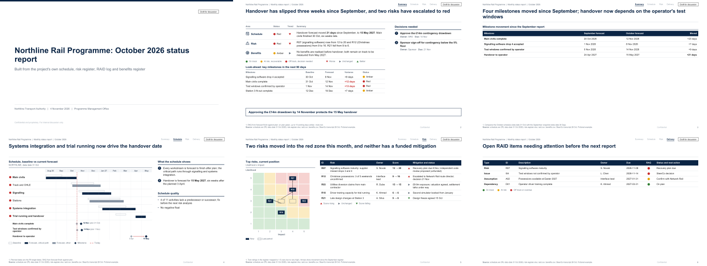

Source: [`examples/northline-monthly/deck.md`](../examples/northline-monthly/deck.md) | [PDF](../examples/northline-monthly/deck.pdf) | [PPTX](../examples/northline-monthly/deck.pptx)

## PMO: SteerCo pack

Decisions first, then status, schedule, risk, cost, workstreams and recovery options.

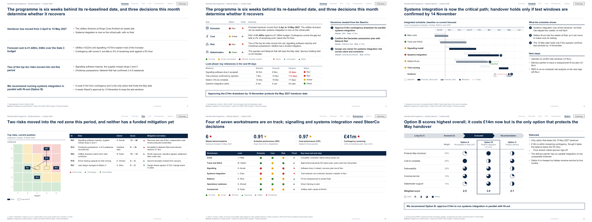

Source: [`examples/northline-rail-steerco/deck.md`](../examples/northline-rail-steerco/deck.md) | [PDF](../examples/northline-rail-steerco/deck.pdf) | [PPTX](../examples/northline-rail-steerco/deck.pptx)

## PMO: Assurance / IV&V health check

Ratings by area, significant findings with management responses, recommendation tracker.

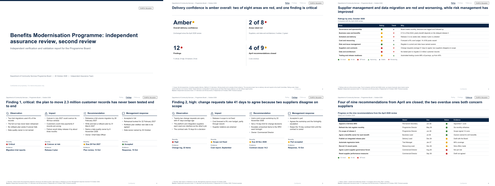

Source: [`examples/assurance-review/deck.md`](../examples/assurance-review/deck.md) | [PDF](../examples/assurance-review/deck.pdf) | [PPTX](../examples/assurance-review/deck.pptx)

## PMO: Risk review

Heat map with movement, mitigation options for the top risk, sensitivity, RAID.

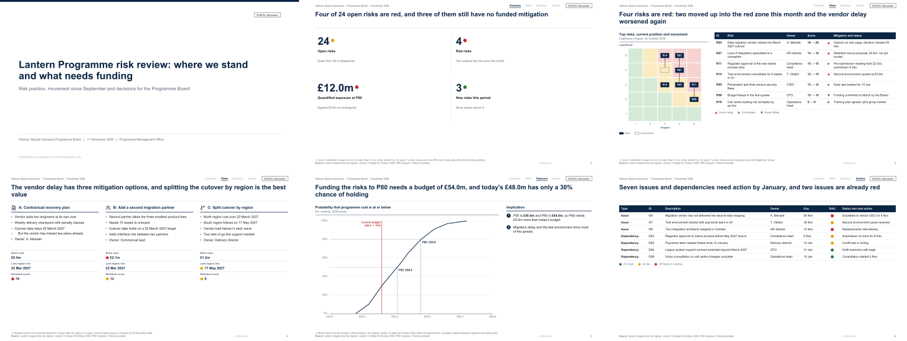

Source: [`examples/risk-review/deck.md`](../examples/risk-review/deck.md) | [PDF](../examples/risk-review/deck.pdf) | [PPTX](../examples/risk-review/deck.pptx)

## Capital projects: Gate 3 investment decision paper

Stage gates, options, cost build-up with estimate class, QRA confidence, the resolution.

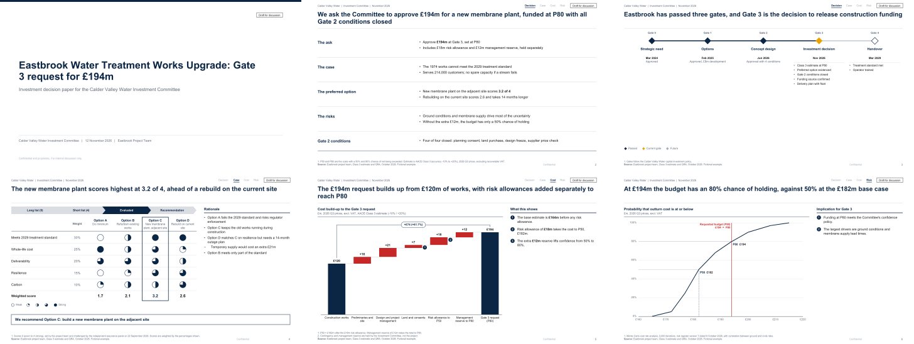

Source: [`examples/gate-paper/deck.md`](../examples/gate-paper/deck.md) | [PDF](../examples/gate-paper/deck.pdf) | [PPTX](../examples/gate-paper/deck.pptx)

## Capital projects: Independent cost and schedule review

Project view against the review's view of cost and date, findings by severity.

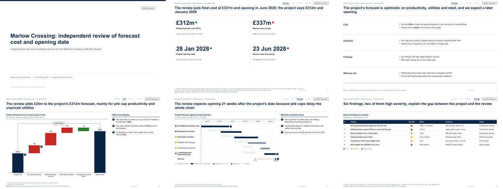

Source: [`examples/independent-review/deck.md`](../examples/independent-review/deck.md) | [PDF](../examples/independent-review/deck.pdf) | [PPTX](../examples/independent-review/deck.pptx)

## Strategy: Market entry

Market sizing, where to play, entry mode options and the recommendation.

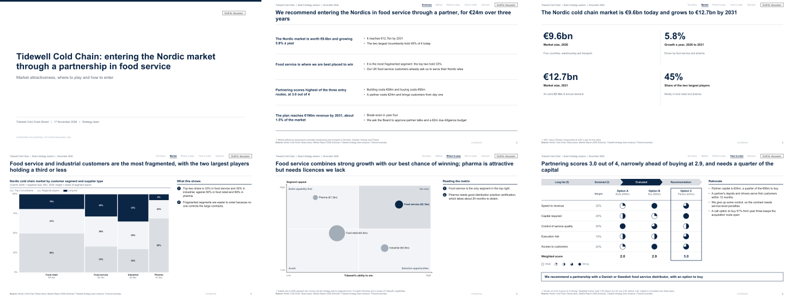

Source: [`examples/market-entry/deck.md`](../examples/market-entry/deck.md) | [PDF](../examples/market-entry/deck.pdf) | [PPTX](../examples/market-entry/deck.pptx)

## Strategy: Growth strategy

Momentum against ambition, the revenue bridge by initiative, options and roadmap.

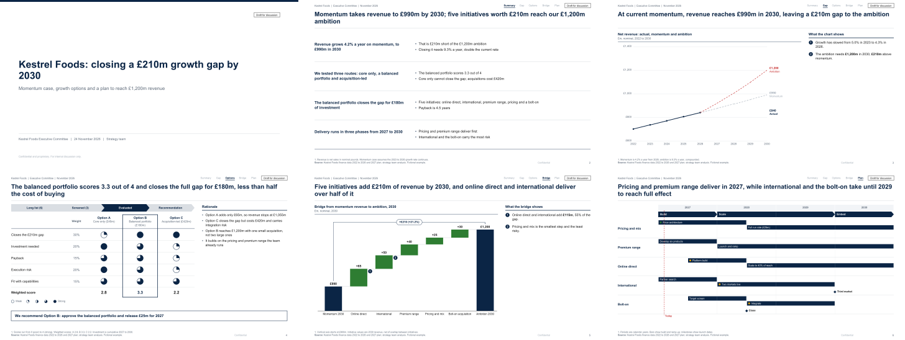

Source: [`examples/growth-strategy/deck.md`](../examples/growth-strategy/deck.md) | [PDF](../examples/growth-strategy/deck.pdf) | [PPTX](../examples/growth-strategy/deck.pptx)

## Management + capital: Diagnostic, savings plan and capital programme

Issue and driver trees, benchmark, Marimekko, quotes, roadmap, benefits, S-curve, P-curve, tornado.

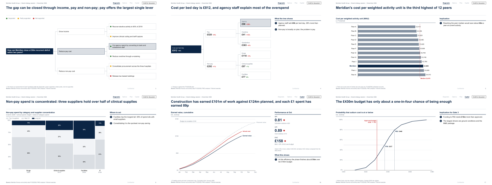

Source: [`examples/meridian-cost-review/deck.md`](../examples/meridian-cost-review/deck.md) | [PDF](../examples/meridian-cost-review/deck.pdf) | [PPTX](../examples/meridian-cost-review/deck.pptx)

## Management: Operating model and org design

Design principles, today against target, structure, decision rights, transition roadmap.

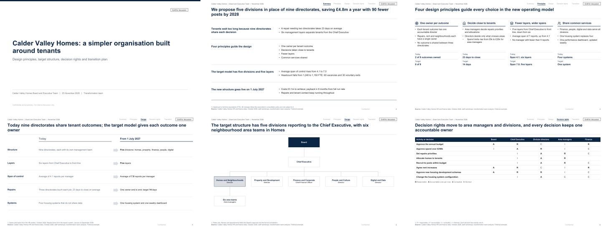

Source: [`examples/operating-model/deck.md`](../examples/operating-model/deck.md) | [PDF](../examples/operating-model/deck.pdf) | [PPTX](../examples/operating-model/deck.pptx)

## Management: Post-merger integration plan

Day 1 and Day 100, must-haves, synergies by type, integration office.

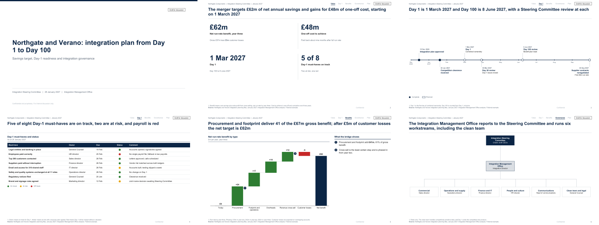

Source: [`examples/post-merger-integration/deck.md`](../examples/post-merger-integration/deck.md) | [PDF](../examples/post-merger-integration/deck.pdf) | [PPTX](../examples/post-merger-integration/deck.pptx)

## Any: The same SteerCo pack on a client template

Built on the client's own master, layouts, fonts and colours.

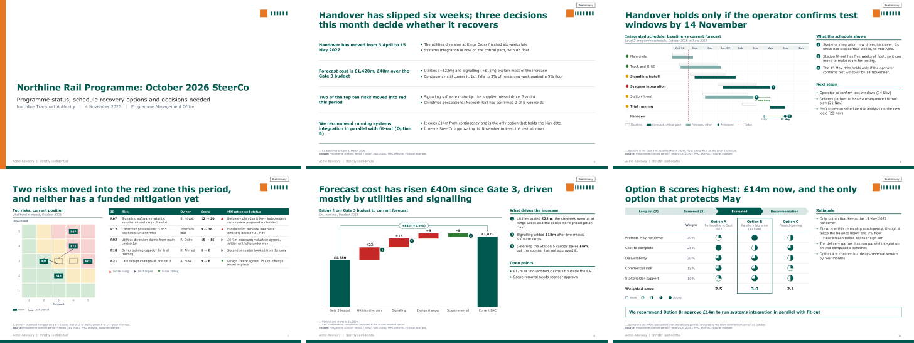

Source: [`examples/template-demo/deck.md`](../examples/template-demo/deck.md) | [PDF](../examples/template-demo/deck.pdf) | [PPTX](../examples/template-demo/deck.pptx)
